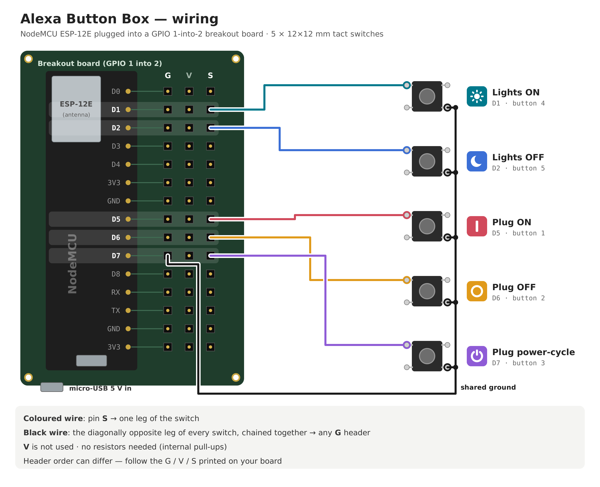

# Alexa Button Box

A 3D-printed wall box with five physical buttons that control a smart plug and Alexa lights.

```
button box ──Wi-Fi──► home server (192.168.1.87) ──local Wi-Fi──► Feit smart plug   (no cloud)
                                                 └──internet──► Alexa routine ──► lights
```

The plug is switched **directly on your network**: fast, and it keeps working when the internet is down. The lights are Alexa-only, so the server runs an Alexa routine for those.

| Row | Button | Symbol on lid | Pin | What happens |
|---|---|---|---|---|
| Top | 1 | `|` | D5 | Plug **ON** (local) |
| Top | 2 | `O` | D6 | Plug **OFF** (local) |
| Top | 3 | power symbol | D7 | Plug **OFF → wait 10 s → ON** (local) |
| Bottom | 4 | sun | D1 | Lights **ON** (Alexa routine) |
| Bottom | 5 | moon | D2 | Lights **OFF** (Alexa routine) |

## Download

Grab the **[latest release](https://github.com/SFXShannon/alexa-button-box/releases/latest)**. It has the STLs, the Arduino sketch, the server folder as its own zip, and the wiring diagram.

| Release | Use it if |
|---|---|
| **v2.x** (latest) | You have the home server + breakout board (this README) |
| [v1.1.0](https://github.com/SFXShannon/alexa-button-box/releases/tag/v1.1.0) | Breakout board, no server — buttons call Alexa trigger URLs directly |
| [v1.0.0](https://github.com/SFXShannon/alexa-button-box/releases/tag/v1.0.0) | Bare NodeMCU without the breakout board, no server |

## Parts

- NodeMCU ESP-12E development board (CP2102)
- "GPIO 1 into 2" ESP8266 expansion / breakout board (63.5 × 63 mm, micro-USB power)
- 5 × 12×12×7.3 mm tact switches with caps
- Female dupont jumper leads
- 8 × M2.5 self-tapping screws: 4 × 6 mm (board) and 4 × 8 mm countersunk (lid)
- 5 V USB phone charger + micro-USB cable
- An always-on Windows PC on the same network (the home server)
- Feit Wi-Fi smart plug (Tuya-based, no Matter logo) and Alexa-controlled lights
- About 80 g of PLA or PETG

## What's in this repo

| Path | What it is |
|---|---|
| `base.stl`, `lid.stl` | The case, ready to print |
| `make_case.py` | Parametric generator for the case: change sizes and re-run |
| `AlexaButtons/AlexaButtons.ino` | Arduino sketch for the NodeMCU |
| `server/` | The home-server program, config template and Windows installer |
| `docs/wiring.png` | Wiring diagram |

## 1. Print

- `base.stl`: print open side up. Outside 84.8 × 84.8 × 42 mm. No supports.
- `lid.stl`: print **as exported** (flat face on the bed, button pockets pointing up). No supports.
- PLA/PETG, 0.2 mm layers, 3 walls, 20% infill is plenty.
- Hang it with the **keyhole slots pointing up** so the plug row ends up on top.
- **Measure your breakout board first.** The case assumes a 63.5 × 63 mm board with screw holes **57.5 × 57 mm apart** (centre to centre). If yours differs, edit `BOARD_L / BOARD_W` and `HOLE_DX / HOLE_DY` in `make_case.py` and run `python make_case.py` (needs `pip install manifold3d trimesh numpy`). If the lid is too tight or loose, change `FIT`.

## 2. Wire



Plug the NodeMCU into the breakout board (match the antenna mark). Every pin on the breakout has its own **G / V / S** header group.

- **Signal:** one leg of each switch → the **S** header of its pin (D5, D6, D7, D1, D2).
- **Ground:** the **diagonally opposite** leg of each switch → a **G** header. Either give each switch its own G, or chain all five together and run one wire to any G (as in the diagram).
- Leave **V** unused. No resistors needed (the sketch uses internal pull-ups).
- Header order varies between boards: follow the G / V / S printed on yours.

Snap each switch into its holder on the underside of the lid: turn it so its **legs point toward the two open sides** of the holder, then push until it clicks under the two hooks. Press the caps on from the front. If your switches are a different height and don't click in (or rattle), change `BODY_H` in `make_case.py`.

Screw the breakout board onto the four posts (M2.5 × 6 mm) with the NodeMCU's **micro-USB end toward the tall window** in the side wall, and power it from a 5 V USB charger through the NodeMCU's USB. Screw the lid on with the four countersunk M2.5 × 8 mm screws.

## 3. Get the plug's local key (one time, ~20 min)

The Feit plug runs on the Tuya platform. To control it locally the server needs its **device ID** and **local key**.

1. **Move the plug to the Smart Life app.** Install *Smart Life* on your phone and make an account. Remove the plug from the Feit app, factory-reset it (hold its button ~5 s until it blinks fast), then add it in Smart Life. Enable the **Smart Life** skill in the Alexa app if you still want voice control of the plug.
2. **Make a free Tuya developer account** at [platform.tuya.com](https://platform.tuya.com) → *Cloud → Development → Create Cloud Project*. Industry: Smart Home, development method: Smart Home, data center: **Western America**. Accept the default API services.
3. In the project: *Devices → Link App Account → Add App Account* and scan the QR code with Smart Life (*Me → scan icon*). Your plug appears in the device list.
4. On the home server, in a terminal:
   ```
   pip install tinytuya
   python -m tinytuya wizard
   ```
   Paste the project's **Access ID** and **Access Secret** (*Overview* tab), region `us`, and say **yes** to scanning the network. It prints the plug's `id`, `key`, local IP and version.
5. Give the plug a **fixed IP** in your router (DHCP reservation) so it doesn't move. If you can't, leave `"ip": ""` in the config and the server will find it automatically (slightly slower).

The local key only changes if you re-pair the plug. The Tuya developer trial expiring later doesn't matter, because the server talks to the plug directly.

## 4. Set up the home server

1. Install **Python 3** on the server from python.org. The scripts find it even if it isn't on PATH, and install `tinytuya` for you.
2. Copy the `server` folder to it, e.g. `C:\AlexaButtonBox\server`.
3. Copy `config.example.json` to `config.json` and fill in:
   - `plug.id`, `plug.local_key`, `plug.ip`, `plug.version` from the wizard
   - `token`: any password; the same value goes in the sketch
   - `cycle_seconds`: how long the power-cycle keeps the plug off (default 10)
   - `lights.on` / `lights.off`: the two virtualsmarthome trigger URLs (next section)
4. **Test:** double-click `start_server.bat`, then open `http://192.168.1.87:8765/plug/on?token=YOURTOKEN` in a browser. The plug should click on.
5. **Start on boot:** open PowerShell **as Administrator** in the server folder and run
   ```
   powershell -ExecutionPolicy Bypass -File .\install_windows.ps1
   ```
   This opens port 8765 in the firewall (private networks only) and adds a scheduled task that runs the server hidden at startup.

`config.json` holds your plug's key, so it's excluded from git. Don't commit or share it.

## 5. Set up the lights in Alexa

1. Go to **virtualsmarthome.xyz → URL Routine Trigger**, sign in with your Amazon account, and create two triggers: `Lights On Button` and `Lights Off Button`. Put their URLs in the server's `config.json`.
2. In the Alexa app, enable the **Virtual Smart Home** skill and let it discover devices.
3. Create two routines (*More → Routines → +*):
   - *When:* `Lights On Button` pressed → *Action:* your lights (or a room / group) → Power On
   - *When:* `Lights Off Button` pressed → *Action:* lights → Power Off

## 6. Flash the sketch

1. Arduino IDE → *Preferences → Additional Boards Manager URLs*: `http://arduino.esp8266.com/stable/package_esp8266com_index.json`, then *Boards Manager* → install **esp8266**.
2. Board: **NodeMCU 1.0 (ESP-12E Module)**. Install the CP2102 USB driver if the COM port doesn't show up.
3. Open `AlexaButtons/AlexaButtons.ino` and fill in your Wi-Fi name/password (must be a **2.4 GHz** network), `SERVER` (`http://192.168.1.87:8765`) and the same `TOKEN` as the server.
4. Upload. Open Serial Monitor at 115200 to watch it connect.

## How it behaves

- **LED on the NodeMCU:** 2 blinks at boot = ready · 1 blink after a press = done · 5 fast blinks = failed.
- Pressing ON or OFF during a power-cycle cancels the cycle.
- Presses within 1 s of the last one are ignored, so a bouncy button can't fire twice.
- Everything the server does is logged to `server/button_server.log`.

## Server URLs

All requests need `?token=YOURTOKEN`. Handy for testing from a browser or adding other triggers later.

| URL | Does |
|---|---|
| `/plug/on` | Plug on (cancels a running power-cycle) |
| `/plug/off` | Plug off (cancels a running power-cycle) |
| `/plug/cycle` | Off → wait `cycle_seconds` → on |
| `/lights/on` | Fires the lights-on Alexa trigger |
| `/lights/off` | Fires the lights-off Alexa trigger |
| `/status` | Shows the plug's current state |

## Troubleshooting

| Symptom | Check |
|---|---|
| 5 fast blinks on every button | Server not running, wrong `SERVER` address or `TOKEN` in the sketch, or the firewall rule is missing. Open `http://192.168.1.87:8765/status?token=YOURTOKEN` from another device on your Wi-Fi. |
| `plug error: Check device key or version` | `local_key` or `version` is wrong. Re-run `python -m tinytuya wizard`; the key changes every time the plug is re-paired. |
| `plug error` about timeouts | The plug's IP changed. Set a DHCP reservation, or set `"ip": ""` so the server finds it. |
| Plug works but lights don't | Check the trigger URLs in `config.json`, then open each one in a browser: the Alexa routine should run. |
| `'python' is not recognized` | Use the latest `start_server.bat` (v2.0.2+), which finds Python without PATH. If it says Python isn't found, install it from python.org. |
| Box never connects to Wi-Fi (LED keeps flickering) | ESP8266 only does 2.4 GHz; check the SSID and password. |
| Lid too tight or loose | Change `FIT` in `make_case.py` and reprint the lid. |

## License

MIT, see [LICENSE](LICENSE).
